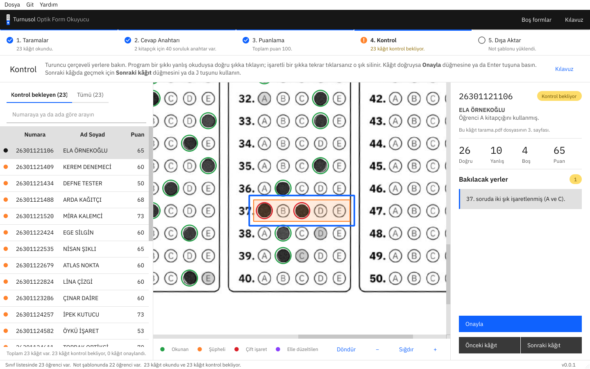
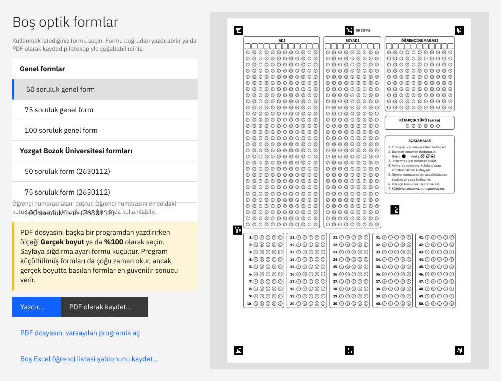
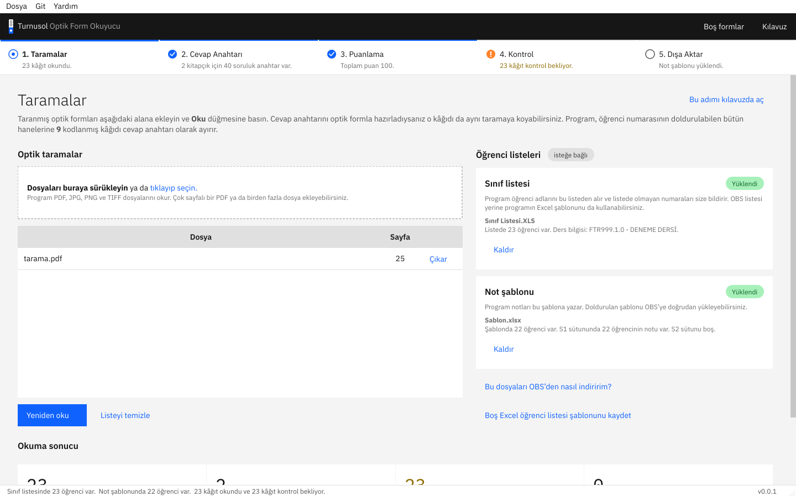
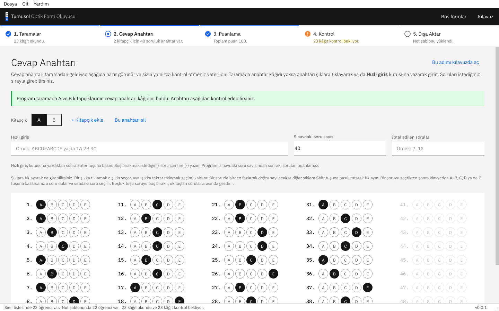
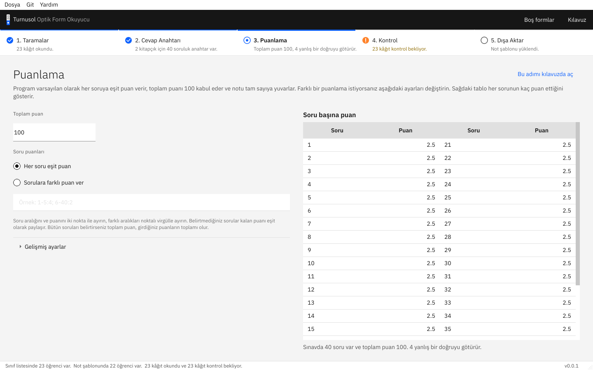
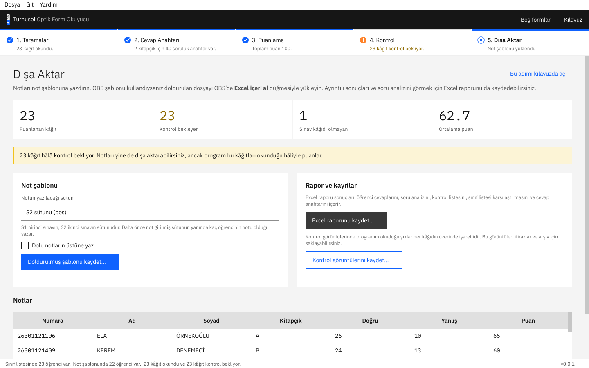
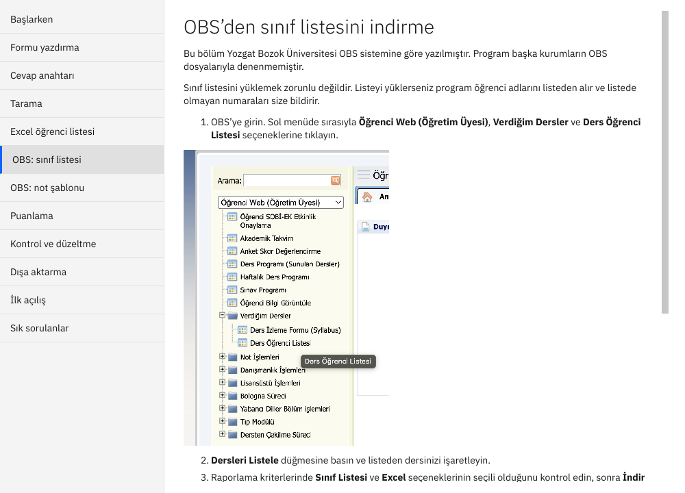

<p align="center"></p>

<h1 align="center">Turnusol</h1>

<p align="center">Kâğıda basılan optik formları tarayıcıdan okuyan, puanlayan ve notları Excel’e yazan ücretsiz bir program.</p>

<p align="center"><a href="https://github.com/fr3sby/turnusol/releases/latest"><b>Son sürümü indir</b></a></p>

---

Turnusol, sınav kâğıtlarını özel bir optik okuyucuya gerek kalmadan okur. Formu sıradan bir yazıcıdan basarsınız, öğrenciler kurşun kalemle doldurur, kâğıtları sıradan bir tarayıcıyla PDF olarak taratırsınız. Program kâğıtları okur, cevap anahtarına göre puanlar, emin olamadığı yerleri size gösterir ve notları Excel dosyasına yazar.



## İçindekiler

- [İndirme ve kurulum](#i̇ndirme-ve-kurulum)
- [Formları yazdırma](#formları-yazdırma)
- [Sınavdan sonra: adım adım kullanım](#sınavdan-sonra-adım-adım-kullanım)
- [Öğrenci listesi ve not şablonu](#öğrenci-listesi-ve-not-şablonu)
- [Sık sorulanlar](#sık-sorulanlar)
- [Kaynak koddan çalıştırma](#kaynak-koddan-çalıştırma)
- [Atıf ve lisans](#atıf-ve-lisans)
- [İletişim](#i̇letişim)

## İndirme ve kurulum

Programı kullanmak için Python ya da başka bir program kurmanız gerekmez.

1. [Sürümler](https://github.com/fr3sby/turnusol/releases/latest) sayfasını açın.
2. Bilgisayarınıza uygun dosyayı indirin:
   - Windows için `Turnusol-...-Windows.zip`
   - Apple işlemcili Mac için (M1 ve sonrası) `Turnusol-...-Mac-AppleSilikon.zip`
   - Intel işlemcili Mac için `Turnusol-...-Mac-Intel.zip`
3. İndirdiğiniz zip dosyasını açın.
   - **Windows:** Açılan `Turnusol` klasörünü istediğiniz bir yere taşıyın ve klasördeki `Turnusol.exe` dosyasını çalıştırın. Klasördeki diğer dosyalar programın parçasıdır ve silinmemelidir.
   - **Mac:** `Turnusol` uygulamasını **Uygulamalar** klasörüne sürükleyin ve oradan açın.

### İlk açılışta çıkan uyarı

Program Microsoft ya da Apple tarafından imzalanmadığı için işletim sistemi ilk açılışta bir uyarı gösterir. Bu uyarıyı yalnızca bir kez geçmeniz gerekir.

- **Windows:** “Windows bilgisayarınızı korudu” uyarısında **Ek bilgi** bağlantısına, ardından **Yine de çalıştır** düğmesine tıklayın.
- **Mac:** Uygulamayı bir kez açmayı deneyin ve çıkan pencereyi **Bitti** düğmesiyle kapatın. Ardından **Sistem Ayarları** içinde **Gizlilik ve Güvenlik** bölümünü açın. Sayfanın altındaki Turnusol uyarısının yanında bulunan **Yine de Aç** düğmesine tıklayın ve parolanızı girin.

## Formları yazdırma

Boş formlar programın içindedir. Pencerenin üstündeki **Boş formlar** düğmesine basın. Açılan pencerede formu seçip **Yazdır** düğmesiyle doğrudan yazdırabilir ya da **PDF olarak kaydet** düğmesiyle bilgisayarınıza kaydedebilirsiniz. Formların PDF dosyalarını [buradan](turnusol/formlar) da indirebilirsiniz.



### Hangi formu seçmeliyim?

Program iki form takımı okur. Her takımda 50, 75 ve 100 soruluk birer A4 form vardır.

| Form takımı | Öğrenci numarası | Kimler kullanabilir? |
|---|---|---|
| **Genel formlar** | Alan boştur. Öğrenci numarasını en soldaki kutudan başlayarak kodlar (en çok 11 hane). | Her kurum |
| **Yozgat Bozok Üniversitesi formları** | İlk yedi hane (2630112) basılıdır. Öğrenci yalnızca son dört haneyi kodlar. | Yozgat Bozok Üniversitesi |

Sınavdaki soru sayısına eşit ya da ondan büyük bir form seçin. Örneğin 40 soruluk bir sınav için 50 soruluk formu kullanabilirsiniz. Program anahtarı girilmeyen soruları puanlamaz.

### Yazdırırken dikkat edilecekler

- PDF dosyasını başka bir programdan yazdırıyorsanız ölçeği **Gerçek boyut** ya da **%100** olarak seçin. **Sayfaya sığdır** ayarı formu küçültür.
- Kâğıdın kenarlarındaki küçük siyah kareler hizalama işaretleridir. Bu kareler kırpılmamalı ve üzerlerine zımba ya da yazı gelmemelidir.
- Formu fotokopiyle çoğaltabilirsiniz. Ancak koyu ya da gri zeminli fotokopiler okumayı zorlaştırır.
- Öğrenciler kurşun kalem kullanmalı ve daireleri tamamen doldurmalıdır.

### Cevap anahtarını optik formla vermek

Anahtarı programa elle de girebilirsiniz. Optik formla vermek isterseniz boş bir forma doğru cevapları kodlayın ve öğrenci numarası alanında doldurulabilen bütün hanelere **9** kodlayın. Genel formda on bir hanenin hepsine, Yozgat Bozok Üniversitesi formunda ise son dört haneye 9 kodlanır. Bu kâğıdı öğrenci kâğıtlarıyla birlikte taratın. Program anahtar kâğıdını kendisi ayırır. Sınavda kitapçık kullanıyorsanız her kitapçık için ayrı bir anahtar kâğıdı doldurun ve kitapçık türünü işaretleyin.

## Sınavdan sonra: adım adım kullanım

Programın penceresinin üstünde beş adım vardır. Adımları soldan sağa izlemeniz yeterlidir. Programdaki **Kılavuz** düğmesi her adımı ayrıntılı olarak anlatır.

### 1. Taramalar

Kâğıtları 200–300 dpi çözünürlükte ve gri tonlu olarak taratın. Bütün kâğıtları tek bir çok sayfalı PDF dosyasına taratmak işinizi kolaylaştırır. Kâğıtların ters ya da eğik taranması sorun değildir. Tarama dosyasını pencereye sürükleyin ve **Oku** düğmesine basın. Sınıf listesini ve not şablonunu da isterseniz bu adımda yüklersiniz.



### 2. Cevap anahtarı

Taramada anahtar kâğıdı varsa program anahtarı oradan alır. Yoksa anahtarı şıklara tıklayarak, klavyeyle ya da `ABCDE...` biçiminde yazarak girersiniz. Sınavda kitapçık kullanıyorsanız her kitapçık için ayrı bir anahtar girersiniz. Bir soruda birden fazla şık doğru sayılabilir ve bir soru iptal edilebilir.



### 3. Puanlama

Toplam puanı, soruların puanını ve yanlışların doğruyu götürüp götürmeyeceğini bu adımda ayarlarsınız. Soruların puanı farklıysa `1-5:4; 6-40:2` gibi aralıklar yazabilirsiniz. İptal edilen bir sorunun herkese doğru sayılmasını ya da puanının diğer sorulara dağıtılmasını seçebilirsiniz.



### 4. Kontrol

Program hafif işaretleri, iki şık işaretlenmiş soruları ve eksik okunan numaraları bu adımda listeler. Kâğıdın görüntüsünde sorunlu yer turuncu bir çerçeveyle gösterilir. Program bir şıkkı yanlış okuduysa doğru şıkka tıklayarak düzeltirsiniz. Kâğıt doğruysa **Onayla** düğmesine basarsınız. Görüntüyü yakınlaştırabilir ve döndürebilirsiniz.


### 5. Dışa aktar

Notları not şablonuna yazdırır ve Excel raporunu kaydedersiniz. Rapor sonuçları, öğrenci cevaplarını, soru analizini, kontrol listesini ve sınıf listesi karşılaştırmasını içerir. Program dolu bir not hücresinin üzerine siz izin vermedikçe yazmaz. İsterseniz programın okuduğu şıkların işaretlendiği kâğıt görüntülerini de itirazlar ve arşiv için kaydedebilirsiniz.



## Öğrenci listesi ve not şablonu

Öğrenci listesi yüklemek zorunlu değildir. Listeyi yüklerseniz program öğrenci adlarını listeden alır, listede olmayan numaraları ve sınava girmeyen öğrencileri size bildirir.

**Excel şablonu (her kurum için):** Programın **Dosya** menüsündeki **Excel öğrenci listesi şablonunu kaydet** komutuyla boş bir şablon kaydedin. Şablonda Öğrenci No, Adı, Soyadı, S1 ve S2 sütunları vardır. Öğrencileri girdikten sonra dosyayı hem sınıf listesi hem de not şablonu olarak yükleyebilirsiniz. Program notları seçtiğiniz sütuna yazar.

**OBS dosyaları (yalnızca Yozgat Bozok Üniversitesi):** Program OBS’den indirilen sınıf listesini (`Sınıf Listesi.XLS`) ve OBS not şablonunu doğrudan okur. Doldurulan şablonu OBS’ye **Excel içeri al** düğmesiyle yükleyebilirsiniz. Bu uyum yalnızca Yozgat Bozok Üniversitesi OBS sistemiyle denenmiştir. Dosyaların OBS’den nasıl indirileceği programın kılavuzunda resimlerle anlatılır.



## Sık sorulanlar

**Bir kâğıt “okunamadı” olarak görünüyor. Ne yapmalıyım?**
Kâğıdın kenarındaki siyah kareler kırpılmış ya da kâğıt çok koyu taranmış olabilir. Kâğıdı düz ve tam sayfa olarak yeniden taratın.

**Öğrenci numarasını yanlış kodlamış. Nasıl düzeltirim?**
Kontrol ekranında numara sütunundaki doğru rakama tıklayın. Sınıf listesini yüklediyseniz program listede olmayan numaraları size zaten bildirir.

**Aynı sınavda farklı formlar kullanılabilir mi?**
Kullanılabilir. Program her kâğıdın hangi form olduğunu köşelerdeki işaretlerden anlar.

**Programın verileri bir yere gönderiliyor mu?**
Gönderilmiyor. Program bütün işlemleri bilgisayarınızda yapar ve internete bağlanmaz.

## Kaynak koddan çalıştırma

Programı geliştirmek isteyenler kaynak koddan çalıştırabilir. Python 3.10 ya da daha yeni bir sürüm gerekir.

```
pip install -r requirements.txt
python -m turnusol.gui
```

Komut satırı sürümü de vardır:

```
python -m turnusol taramalar.pdf --liste "Sınıf Listesi.xlsx" --toplam 100 --cikti sonuc
```

Windows ve Mac paketleri GitHub Actions ile derlenir (`.github/workflows/derle.yml`). `v` ile başlayan bir etiket gönderildiğinde derlenen dosyalar o sürümün sayfasına eklenir. Formların kaynağı `araclar/gen_forms.py` dosyasıdır. Basılmış formlar okunmaya devam etsin diye mevcut formların yerleşimi değiştirilmez. Yeni bir form yeni işaret numaraları alır.

## Atıf ve lisans

Turnusol, Ian Sanders’ın geliştirdiği açık kaynaklı [OpenMCR](https://github.com/iansan5653/open-mcr) projesinden (Copyright © 2019 Ian Sanders) türetilmiştir. Formlar, okuma yöntemi ve arayüz bu proje temel alınarak yeniden yazılmıştır.

Turnusol, OpenMCR gibi [GNU Genel Kamu Lisansı sürüm 3](LICENSE) (GPL-3.0) ile dağıtılır. Programı bu lisansın koşullarına uyarak kullanabilir, değiştirebilir ve paylaşabilirsiniz. Program hiçbir garanti verilmeden sunulur. Arayüzde kullanılan [IBM Plex](https://github.com/IBM/plex) yazı tipleri SIL Open Font License 1.1 ile dağıtılır.

## İletişim

Turnusol, Uzm. Fzt. Satuk Buğrahan Yinanç tarafından geliştirilmiştir. Karşılaştığınız hataları ve önerilerinizi [S.bugrahan.yinanc@yobu.edu.tr](mailto:S.bugrahan.yinanc@yobu.edu.tr) adresine ya da bu sayfadaki [Issues](https://github.com/fr3sby/turnusol/issues) bölümüne iletebilirsiniz.
